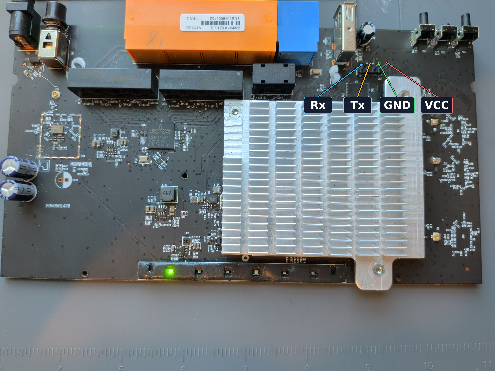
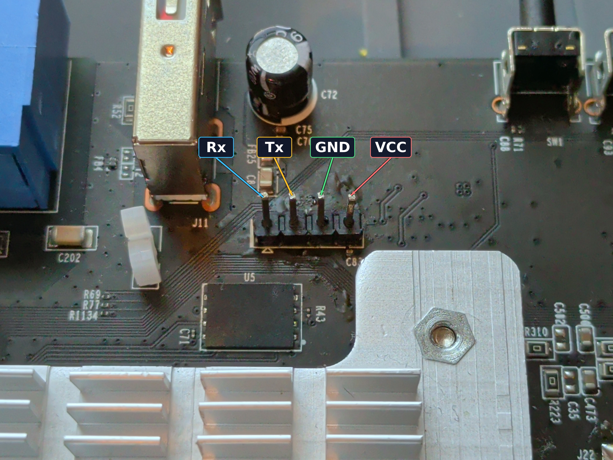
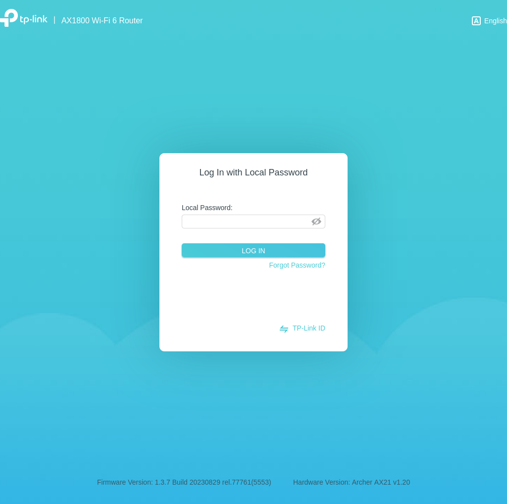

# Work Logs

## 2026-11-02 - UART access and Ethernet

I'm working with an Archer AX21 router which I had laying around. The hardware
revision is **1.26**. CFE reports board ID `TP6755_AX20V1`; Linux reports
`Broadcom BCM947622`, kernel `4.1.52`, and 256 MiB RAM.

### Identifying and soldering the UART port

With the board unpowered, I used the multimeter's continuity function
between the UART pads and the grounded heat shield to identify GND.

I then powered the board and used the voltmeter to check the other pads
relative to GND. A varying voltage during boot suggested TX; readable boot
output confirmed it. I guessed RX from the remaining candidate and
confirmed it when my typed commands reached the console. The voltage used is 3.3 V.

The UART connections were missing header pins, so I soldered one on.

The board-side pins are **Rx, Tx, GND, VCC**, left to right in these photos.
I connect adapter TX to Rx, adapter RX to Tx, and GND to GND, leaving VCC
disconnected.





I connected at 115200 baud (which I guessed and worked):

```sh
sudo minicom -D /dev/ttyUSB0 -b 115200
```

### Getting a shell through CFE

Normal boot stopped at `Archer_AX21 login:`. I don't
know the login or password for root, so I wanted to dump the root
filesystem to find how the root login is setup and see if I can get
the credentials.

I interrupted startup into CFE, the bootloader, by repeatedly pressing
`ENTER` after powering the board. I checked `help`, `p`, `help ba`, and `help r`.

Appending `init=/bin/sh` didn't work: a later `init=/etc/preinit` overrode it.
I replaced the arguments while preserving the filesystem and console:

```text
ba r "isolcpus=3 root=ubi:rootfs_ubifs ubi.mtd=0 rootfstype=ubifs console=ttyAMA0 earlyprintk debug irqaffinity=0 pci=pcie_bus_safe init=/bin/sh"
r
```

`echo $$` returned `1`: my shell replaced normal initialization.
These changes do not seem to survive a power cycle.

The following is some system info:

```sh
$ uname -a
Linux (none) 4.1.52 #1 SMP PREEMPT Fri Nov 25 17:25:31 CST 2022 armv7l GNU/Linux
$ free -h
             total         used         free       shared      buffers
Mem:        250432        92040       158392            0            0
$ cat /proc/cpuinfo 
processor       : 0
model name      : ARMv7 Processor rev 5 (v7l)
BogoMIPS        : 100.00
Features        : half thumb fastmult vfp edsp neon vfpv3 tls vfpv4 idiva idivt vfpd32 lpae 
CPU implementer : 0x41
CPU architecture: 7
CPU variant     : 0x0
CPU part        : 0xc07
CPU revision    : 5

processor       : 1
model name      : ARMv7 Processor rev 5 (v7l)
BogoMIPS        : 100.00
Features        : half thumb fastmult vfp edsp neon vfpv3 tls vfpv4 idiva idivt vfpd32 lpae 
CPU implementer : 0x41
CPU architecture: 7
CPU variant     : 0x0
CPU part        : 0xc07
CPU revision    : 5

processor       : 2
model name      : ARMv7 Processor rev 5 (v7l)
BogoMIPS        : 100.00
Features        : half thumb fastmult vfp edsp neon vfpv3 tls vfpv4 idiva idivt vfpd32 lpae 
CPU implementer : 0x41
CPU architecture: 7
CPU variant     : 0x0
CPU part        : 0xc07
CPU revision    : 5

processor       : 3
model name      : ARMv7 Processor rev 5 (v7l)
BogoMIPS        : 100.00
Features        : half thumb fastmult vfp edsp neon vfpv3 tls vfpv4 idiva idivt vfpd32 lpae 
CPU implementer : 0x41
CPU architecture: 7
CPU variant     : 0x0
CPU part        : 0xc07
CPU revision    : 5

Hardware        : Generic DT based system
Revision        : 0000
Serial          : 0000000000000000
```

### Bringing up Ethernet

Bypassing startup also skipped network setup. I mounted procfs with
`mount -t proc proc /proc`, then loaded the vendor's driver sequence:

```sh
insmod /lib/modules/*/extra/bcmlibs.ko
insmod /lib/modules/*/extra/wlcsm.ko
insmod /lib/modules/*/extra/chipinfo.ko
insmod /lib/modules/*/extra/bcm_ingqos.ko
insmod /lib/modules/*/extra/pktflow.ko
insmod /lib/modules/*/extra/cmdlist.ko
insmod /lib/modules/*/extra/archer.ko
insmod /lib/modules/*/extra/bcm_enet.ko
```

The LAN interfaces had all-zero MACs (`HWaddr`).

<details>
<summary>Network interfaces</summary>

```sh
$ ifconfig -a
archer    Link encap:Ethernet  HWaddr 00:00:00:00:00:00  
          inet6 addr: fe80::200:ff:fe00:0/64 Scope:Link
          UP BROADCAST RUNNING MULTICAST  MTU:1500  Metric:1
          RX packets:0 errors:0 dropped:0 overruns:0 frame:0
          TX packets:0 errors:0 dropped:8 overruns:0 carrier:0
          collisions:0 txqueuelen:0 
          RX bytes:0 (0.0 B)  TX bytes:0 (0.0 B)

bcmsw     Link encap:Ethernet  HWaddr 00:00:00:00:00:00  
          BROADCAST MULTICAST  MTU:1500  Metric:1
          RX packets:12 errors:0 dropped:0 overruns:0 frame:0
          TX packets:1 errors:0 dropped:0 overruns:0 carrier:0
          collisions:0 txqueuelen:1000 
          RX bytes:2320 (2.2 KiB)  TX bytes:64 (64.0 B)

eth0      Link encap:Ethernet  HWaddr 00:00:00:00:00:00  
          BROADCAST MULTICAST  MTU:1500  Metric:1
          RX packets:0 errors:0 dropped:0 overruns:0 frame:0
          TX packets:0 errors:0 dropped:0 overruns:0 carrier:0
          collisions:0 txqueuelen:1000 
          RX bytes:0 (0.0 B)  TX bytes:0 (0.0 B)

eth1      Link encap:Ethernet  HWaddr 00:00:00:00:00:00  
          BROADCAST MULTICAST  MTU:1500  Metric:1
          RX packets:12 errors:0 dropped:0 overruns:0 frame:0
          TX packets:0 errors:0 dropped:0 overruns:0 carrier:0
          collisions:0 txqueuelen:1000 
          RX bytes:2320 (2.2 KiB)  TX bytes:0 (0.0 B)

eth2      Link encap:Ethernet  HWaddr 00:00:00:00:00:00  
          BROADCAST MULTICAST  MTU:1500  Metric:1
          RX packets:0 errors:0 dropped:0 overruns:0 frame:0
          TX packets:0 errors:0 dropped:0 overruns:0 carrier:0
          collisions:0 txqueuelen:1000 
          RX bytes:0 (0.0 B)  TX bytes:0 (0.0 B)

eth3      Link encap:Ethernet  HWaddr 00:00:00:00:00:00  
          BROADCAST MULTICAST  MTU:1500  Metric:1
          RX packets:0 errors:0 dropped:0 overruns:0 frame:0
          TX packets:0 errors:0 dropped:0 overruns:0 carrier:0
          collisions:0 txqueuelen:1000 
          RX bytes:0 (0.0 B)  TX bytes:0 (0.0 B)

eth4      Link encap:Ethernet  HWaddr 00:00:00:00:00:00  
          BROADCAST MULTICAST  MTU:1500  Metric:1
          RX packets:0 errors:0 dropped:0 overruns:0 frame:0
          TX packets:0 errors:0 dropped:0 overruns:0 carrier:0
          collisions:0 txqueuelen:1000 
          RX bytes:0 (0.0 B)  TX bytes:0 (0.0 B)

ifb0      Link encap:Ethernet  HWaddr E6:0E:31:F7:76:0E  
          BROADCAST NOARP  MTU:1500  Metric:1
          RX packets:0 errors:0 dropped:0 overruns:0 frame:0
          TX packets:0 errors:0 dropped:0 overruns:0 carrier:0
          collisions:0 txqueuelen:32 
          RX bytes:0 (0.0 B)  TX bytes:0 (0.0 B)

ifb1      Link encap:Ethernet  HWaddr 9A:C8:07:DD:46:FB  
          BROADCAST NOARP  MTU:1500  Metric:1
          RX packets:0 errors:0 dropped:0 overruns:0 frame:0
          TX packets:0 errors:0 dropped:0 overruns:0 carrier:0
          collisions:0 txqueuelen:32 
          RX bytes:0 (0.0 B)  TX bytes:0 (0.0 B)

ip6gre0   Link encap:UNSPEC  HWaddr 00-00-00-00-00-00-00-00-00-00-00-00-00-00-00-00  
          NOARP  MTU:1448  Metric:1
          RX packets:0 errors:0 dropped:0 overruns:0 frame:0
          TX packets:0 errors:0 dropped:0 overruns:0 carrier:0
          collisions:0 txqueuelen:0 
          RX bytes:0 (0.0 B)  TX bytes:0 (0.0 B)

ip6tnl0   Link encap:UNSPEC  HWaddr 00-00-00-00-00-00-00-00-00-00-00-00-00-00-00-00  
          NOARP  MTU:1452  Metric:1
          RX packets:0 errors:0 dropped:0 overruns:0 frame:0
          TX packets:0 errors:0 dropped:0 overruns:0 carrier:0
          collisions:0 txqueuelen:0 
          RX bytes:0 (0.0 B)  TX bytes:0 (0.0 B)

lo        Link encap:Local Loopback  
          LOOPBACK  MTU:65536  Metric:1
          RX packets:0 errors:0 dropped:0 overruns:0 frame:0
          TX packets:0 errors:0 dropped:0 overruns:0 carrier:0
          collisions:0 txqueuelen:0 
          RX bytes:0 (0.0 B)  TX bytes:0 (0.0 B)
```

</details>


I assigned temporary local MACs
`02:00:00:00:77:01` through `02:00:00:00:77:04` to `eth1` through `eth4`,
using `ifconfig eth1 hw ether 02:00:00:00:77:01` and matching values.

```sh
for i in `seq 1 4`; do
    ifconfig "eth$i" hw ether "02:00:00:00:77:0$i"
    ifconfig "eth$i" up
done
```

I then ran
`ifconfig eth1 192.168.77.1 netmask 255.255.255.0 up`
to give the router\`s `eth1` interface an IPv4 address
we can use to communicate using tools like `netcat`.

There was still no physical link. In `/lib/switch/core_phy.sh`, I found
that PHY power control had to be enabled before powering up the LAN ports:

```sh
ethswctl -c powerset-enable -v 1
ethctl eth1 phy-power up
ethctl eth2 phy-power up
ethctl eth3 phy-power up
ethctl eth4 phy-power up
```

With the cable in LAN1, `eth1` reported `RUNNING` and my computer reported
`LOWER_UP`. I didn't need a bridge for this direct connection.

On my computer, the manual address didn't stay applied while NetworkManager
managed the USB adapter. ARP worked, but ping used the Internet interface's
source address. Giving manual configuration sole control fixed it.
Replace `YOUR_USB_INTERFACE` with the adapter name from `ip -br link`:

```sh
USB_IFACE=YOUR_USB_INTERFACE
sudo nmcli device set "$USB_IFACE" managed no
sudo ip link set dev "$USB_IFACE" up
sudo ip address replace 192.168.77.2/24 dev "$USB_IFACE"
ping -I 192.168.77.2 -c 3 -W 2 192.168.77.1
```

The ping returned 3/3 replies.

### Flash dump

From `cat /proc/mtd`, I found a 50 MiB `rootfs` partition (`mtd0`), with
128 KiB erase blocks. `/dev/mtd0ro` exists. `mtd9` (`rootfs_ubifs`) appears
to be a logical UBI view rather than separate physical flash.

```sh
$ cat /proc/mtd 
dev:    size   erasesize  name
mtd0: 03200000 00020000 "rootfs"
mtd1: 03220000 00020000 "rootfs_update"
mtd2: 00800000 00020000 "data"
mtd3: 00100000 00020000 "nvram"
mtd4: 03700000 00020000 "image"
mtd5: 03700000 00020000 "image_update"
mtd6: 004e0000 00020000 "bootfs"
mtd7: 004c0000 00020000 "bootfs_update"
mtd8: 00800000 00020000 "misc2"
mtd9: 02efc000 0001f000 "rootfs_ubifs"
```

I checked `/proc/mounts`: rootfs was read-only. I copied it into the
gitignored `captures/flash/` directory.

On my computer, from this repo, I started the receiver:

```sh
mkdir -p captures/flash
nc -l -n -d 192.168.77.2 9000 > captures/flash/rootfs-mtd0.bin.partial
```

Then I sent the partition from the router:

```sh
busybox nc 192.168.77.2 9000 < /dev/mtd0ro
```

If netcat stays open after all bytes arrive, stop the computer's receiver
with Ctrl+C before checking the hashes.

On my computer:

```sh
wc -c captures/flash/rootfs-mtd0.bin.partial
md5sum captures/flash/rootfs-mtd0.bin.partial
```

On the router:

```sh
md5sum /dev/mtd0ro
```

The dump was **52428800 bytes**, and the MD5 hashes matched without errors.

Keep dumps and credentials out of Git. This partition dump won't include
the NAND spare/OOB data needed for a full physical backup.

### Extracting and inspecting the rootfs

The dump is a UBI container holding the UBIFS filesystem. I'll use
[UBI Reader](https://github.com/onekey-sec/ubi_reader) to extract the files
directly, without mounting the image.

On my computer, from this repo:

```sh
uv tool install --cache-dir analysis/uv-cache ubi-reader
ubireader_display_info -p 131072 captures/flash/rootfs-mtd0.bin.partial
ubireader_extract_files -p 131072 -o analysis/rootfs captures/flash/rootfs-mtd0.bin.partial
```

`uv` installs the tool in an isolated user environment. `-p 131072` is the
128 KiB physical erase-block size. The dump stays unchanged; the output
and download cache go under the gitignored `analysis/` directory.

#### Looking for the password setter

Given that the password is usually set with the `passwd`
utility, I looked for places that call it:

```sh
 $ rg "passwd" -l    
etc/profile
bin/login.sh
sbin/change_smb_conf
sbin/usbuser
sbin/gen_passwd
etc/config/luci
etc/proftpd/proftpd.conf.orig
etc/samba/smb.conf.template
etc/init.d/telnet
etc/uci-defaults/migrate-shadow
etc/init.d/samba
lib/wifi/tplink_brcm.sh
lib/netifd/proto/openvpn.sh
lib/functions.sh
lib/upgrade/keep.d/base-files-essential
usr/bin/ftpasswd
usr/lib/opkg/status
usr/lib/opkg/info/base-filesystem.list
usr/lib/opkg/info/samba36-server.list
usr/lib/opkg/info/proftpd.list
usr/lib/opkg/info/netatalk.list
usr/lib/opkg/info/luci-apps.list
usr/lib/opkg/info/base-filesystem.conffiles
usr/lib/opkg/info/busybox.list
```

Two interesting files are `bin/login.sh` and
`sbin/gen_passwd`. But, inspecting them showed that they
are not what we are looking for.

I then looked at the `/etc/inittab` file, which tells `init`
what processes to launch and when.

```sh
 cat etc/inittab                                                                   
::sysinit:/etc/init.d/rcS S boot
::shutdown:/etc/init.d/rcS K shutdown
#ttyAMA0::askfirst:/bin/ash --login
ttyAMA0::askfirst:/bin/login
```

The interesting one is the last line: it waits for the
user to type `ENTER` (`askfirst`) on the UART shell
(`ttyAMA0`) and then runs `/bin/login`. The latter is
just a symlink to `/bin/busybox`.

```sh
$ ls -l bin/login
lrwxrwxrwx 1 luizdovalle luizdovalle 7 Aug 29  2023 bin/login -> busybox
```

`busybox` is 387 KB executable.

```sh
$ ls -lh bin/busybox 
-rw-rw-r-- 1 luizdovalle luizdovalle 387K Nov 25  2022 bin/busybox
$ file bin/busybox 
bin/busybox: ELF 32-bit LSB executable, ARM, EABI5 version 1 (SYSV), dynamically linked, interpreter /lib/ld-linux.so.3, for GNU/Linux 4.1.0, stripped
$ size bin/busybox 
   text	   data	    bss	    dec	    hex	filename
 390653	   1837	   9152	 401642	  620ea	bin/busybox
$ sha256sum bin/busybox 
07824989d7d7aaaf8f26147c241d8e9ff4271c2d98f77ebe512b0f84d4bc83df  bin/busybox
$ strings bin/busybox | rg -i 'BusyBox v'
BusyBox v1.19.4 (2022-11-25 18:18:26 CST)
```

It has some interesting strings:

```sh
$ strings bin/busybox | rg -i 'shadow|passwd|password|login incorrect|nvram|getfirm'
passwd
Login incorrect
invalid password for '%s'%s
/etc/passwd
/etc/shadow
%s can't change password for %s
can't change locked password for %s
Changing password for %s
Old password: 
incorrect password for %s
Incorrect password
New password: 
Retype password: 
Passwords don't match
password for %s is unchanged
can't update password file %s
Password for %s changed by %s
password for %s is already %slocked
getfirm MODEL
Login: Set root password failed.
Password: 
?pc?d?b?-?l?s???rwxSTstsimilar to old password
Bad password: %s
```

I put the `busybox` binary in Ghidra and looked for the places in
the code where "Login: Set root password failed." was being used.
After poking around the functions that were called around where this
string I used, I found the function at `0x581e4`. It does the following:

#### Function `0x581e4`

Runs `getfirm MODEL` in a shell and reads the output into a 129-byte buffer.

`getfirm` is a shell script in `/sbin` that takes several options and does
something different for each one. When given `MODEL`, `getfirm` calls
`/usr/bin/nvrammanager` and extracts from partition `product-info` the output
`<product_name>` in a line that should look like `product_name:<product_name>`.

```sh
MODEL)
	productinfo="/tmp/productinfo-"$$
	nvrammanager -r $productinfo -p product-info > /dev/null 2>&1
	echo $(grep 'product_name' $productinfo | cut -d : -f 2-)
	rm -f $productinfo >/dev/null 2>&1
```

I was able to run `nvrammanager` from within the root shell I got in the router
(after mounting `tmp` so that I could create files):

```sh
$ mount -t proc proc /proc
$ mount -t tmpfs -o size=16m,nosuid,nodev tmpfs /tmp/
$ nvrammanager -r /tmp/out -p product-info
$ cat /tmp/out
vendor_name:TP-Link
vendor_url:www.tp-link.com
product_name:Archer AX21
device_name:Wireless Router Archer AX21
country:US
product_ver:1.20
hw_ver:00000002
product_id:18000120
special_id:55530000
hw_id:77C226DF6CED8A2286B2F8AC0E999937
oem_id:7916566926586F42029B0F903D05A454
```

So, `<product_name>`, in our case, is `Archer AX21`. I copied over `strace` to the router
and ran `nvrammanager` again. This showed what file it reads to get the information
above:

```sh
openat(AT_FDCWD, "/etc/partition_config/product-info", O_RDONLY) = 4
```

The function then constructs the string `TProuter<product_name>`
(or `TProuterArcher AX21` in our case) and takes its MD5 hash.

```c
sprintf(md5_firm_cmd,"echo -n \'TProuter%s\'|md5sum|cut -d \' \' -f1",product_name_str + 1);
```

It then seems to use the first 8 characters of the MD5 hash as the root password.

In our case, the MD5 hash is give below:

```sh
echo -n TProuterArcher AX21 | md5sum | cut -d ' ' -f1
3c1f74c8f240586526b0e28014c69777
```

Which means that the root password should be `3c1f74c8`.

#### Testing the password

I power-cycled the board and let it get to the login prompt. Using the credentials
worked:

```sh
Archer_AX21 login: root
Password: 


BusyBox v1.19.4 (2022-11-25 18:18:26 CST) built-in shell (ash)
Enter 'help' for a list of built-in commands.

     MM           NM                    MMMMMMM          M       M
   $MMMMM        MMMMM                MMMMMMMMMMM      MMM     MMM
  MMMMMMMM     MM MMMMM.              MMMMM:MMMMMM:   MMMM   MMMMM
MMMM= MMMMMM  MMM   MMMM       MMMMM   MMMM  MMMMMM   MMMM  MMMMM'
MMMM=  MMMMM MMMM    MM       MMMMM    MMMM    MMMM   MMMMNMMMMM
MMMM=   MMMM  MMMMM          MMMMM     MMMM    MMMM   MMMMMMMM
MMMM=   MMMM   MMMMMM       MMMMM      MMMM    MMMM   MMMMMMMMM
MMMM=   MMMM     MMMMM,    NMMMMMMMM   MMMM    MMMM   MMMMMMMMMMM
MMMM=   MMMM      MMMMMM   MMMMMMMM    MMMM    MMMM   MMMM  MMMMMM
MMMM=   MMMM   MM    MMMM    MMMM      MMMM    MMMM   MMMM    MMMM
MMMM$ ,MMMMM  MMMMM  MMMM    MMM       MMMM   MMMMM   MMMM    MMMM
  MMMMMMM:      MMMMMMM     M         MMMMMMMMMMMM  MMMMMMM MMMMMMM
    MMMMMM       MMMMN     M           MMMMMMMMM      MMMM    MMMM
     MMMM          M                    MMMMMMM        M       M
       M
 ---------------------------------------------------------------
   For those about to rock... (Attitude Adjustment, unknown)
 ---------------------------------------------------------------
```

## 2026-11-03 - Exploring the live system as root

My goal today is to explore the live system as root after a normal boot,
using the UART login I found.

First, I wanted to see which users are registered in the system:

```sh
$ root@Archer_AX21:/# cat /etc/passwd
root:x:0:0:root:/root:/bin/ash
daemon:*:1:1:daemon:/var:/bin/false
ftp:*:55:55:ftp:/home/ftp:/bin/false
network:*:101:101:network:/var:/bin/false
nobody:*:65534:65534:nobody:/var:/bin/false
admin:x:1000:0:admin:/var:/bin/false
guest::2000:65534:guest:/var:/bin/false
```

The interesting ones are `nobody`, `admin` and `guest`.

If we look at the passwords, it looks like `admin` has a password set. Also,
the password was set in `2023-08-29`, which is before I got the router.

```sh
root@Archer_AX21:/# cat /etc/shadow
root:x:0:0:99999:7:::
daemon:*:0:0:99999:7:::
ftp:*:0:0:99999:7:::
network:*:0:0:99999:7:::
nobody:*:0:0:99999:7:::
admin:$1$FU4ynIgq$tES3mJOGZo66zCcNFcg041:19598:0:99999:7:::
guest::0:0:99999:7:::
```

The password uses MD5-crypt (`$1`) with `FU4ynIgq` as the salt. The final
salted hash is `tES3mJOGZo66zCcNFcg041`.

I used [`hashcat`](https://hashcat.net/hashcat/) to crack the password above
and got `admin` as the password.

I tried this password in the web interface at `http://192.168.0.1`, but no luck.

.

I then checked what processes are listening for traffic:

```sh
root@Archer_AX21:/www/webpages/locale# netstat -lntup
Active Internet connections (only servers)
Proto Recv-Q Send-Q Local Address           Foreign Address         State       PID/Program name    
tcp        0      0 0.0.0.0:20001           0.0.0.0:*               LISTEN      7421/dropbear
tcp        0      0 127.0.0.1:20002         0.0.0.0:*               LISTEN      7359/tmpServer
tcp        0      0 0.0.0.0:80              0.0.0.0:*               LISTEN      7443/uhttpd
tcp        0      0 0.0.0.0:53              0.0.0.0:*               LISTEN      5939/dnsmasq
tcp        0      0 0.0.0.0:443             0.0.0.0:*               LISTEN      7443/uhttpd
tcp        0      0 127.0.0.1:5916          0.0.0.0:*               LISTEN      9476/acsd2
tcp        0      0 :::1900                 :::*                    LISTEN      5693/miniupnpd
tcp        0      0 :::53                   :::*                    LISTEN      5939/dnsmasq
```

There is an ssh service on port `20001` which would be interesting to explore later. The HTTP web server is
on port `80` and rybs `uhttpd`.

### Following web authentication

I captured login traffic using Firefox's Network panel. Each exchange uses
two POST requests:

- `/cgi-bin/luci/;stok=/login?form=auth`: sends `operation=read` and receives
  `key` and `seq`.
- `/cgi-bin/luci/;stok=/login?form=login`: sends `data` and `sign`; the response
  contains a Base64-encoded `data` string.

I submitted one password four times and another once. The capture contains
five `auth` / `login` pairs, matching those five submissions.

| Field | Observation across the five exchanges |
|---|---|
| Auth response `key` | Same value every time |
| Auth response `seq` | Different value every time |
| Login request `data` | Different every time; 384 characters |
| Login request `sign` | Different every time; 256 characters |
| Login response `data` | Different every time; 152 Base64 characters decoding to 112 bytes |

I took one the login response `data` fields and decoded it, but it's not plaintext:

```sh
printf '%s' 'VqDRQ2yKsMURpZHfBYTAjDka7R59PO3hBjLlOf8GTH+47qrLbcGcd4eXhddwf0r1vYqsQHPn+VmB7SrZveCCA0e/hQnJ1qVw1E1u+8Tcs4+9yQrtB9SMmINLZAM8nK1mXPScm5WC0G2emAKdEJl3JQ==' | base64 -d | xxd
00000000: 56a0 d143 6c8a b0c5 11a5 91df 0584 c08c  V..Cl...........
00000010: 391a ed1e 7d3c ede1 0632 e539 ff06 4c7f  9...}<...2.9..L.
00000020: b8ee aacb 6dc1 9c77 8797 85d7 707f 4af5  ....m..w....p.J.
00000030: bd8a ac40 73e7 f959 81ed 2ad9 bde0 8203  ...@s..Y..*.....
00000040: 47bf 8509 c9d6 a570 d44d 6efb c4dc b38f  G......p.Mn.....
00000050: bdc9 0aed 07d4 8c98 834b 6403 3c9c ad66  .........Kd.<..f
00000060: 5cf4 9c9b 9582 d06d 9e98 029d 1099 7725  \......m......w%
```

Both requests hit the same endpoint:

```
scheme
	http
host
	192.168.0.1
filename
	/cgi-bin/luci/;stok=/login
```

This seems to run a Lua application:

```sh
root@Archer_AX21:/www/webpages/locale# cat /www/cgi-bin/luci 
#!/usr/bin/lua
require "luci.cacheloader"
require "luci.sgi.cgi"
luci.dispatcher.indexcache = "/tmp/luci-indexcache"
luci.sgi.cgi.run()
```

Looking for Lua files in the extracted rootfs, it seems that the code is in `/usr/lib/lua`:


```sh
$ find -type f -name "*.lua" -exec dirname {} \; | sort -u
./lib/autodial
./lib/domain_login
./lib/ffs
./lib/iptv
./lib/nat
./lib/netifd
./lib/wportal
./usr/lib/lua
./usr/lib/lua/cloud
./usr/lib/lua/cloud_req
./usr/lib/lua/cloud/smart_home
./usr/lib/lua/cloud/tp_apps
./usr/lib/lua/log
./usr/lib/lua/luci
./usr/lib/lua/luci/cbi
./usr/lib/lua/luci/controller
./usr/lib/lua/luci/controller/admin
./usr/lib/lua/luci/http
./usr/lib/lua/luci/http/protocol
./usr/lib/lua/luci/model
./usr/lib/lua/luci/model/cbi/admin_network
./usr/lib/lua/luci/model/cbi/firewall
./usr/lib/lua/luci/model/network
./usr/lib/lua/luci/sgi
./usr/lib/lua/luci/smart_home
./usr/lib/lua/luci/sys
./usr/lib/lua/luci/sys/zoneinfo
./usr/lib/lua/luci/tools
./usr/lib/lua/nixio
./usr/lib/lua/socket
./usr/lib/lua/ssl
```

Indeed, if we check where Lua finds its modules inside the router, we find `/usr/lib/lua`:

```sh
root@Archer_AX21:/# lua -e 'print(package.path); print(package.cpath)'
./?.lua;/usr/share/lua/?.lua;/usr/share/lua/?/init.lua;/usr/lib/lua/?.lua;/usr/lib/lua/?/init.lua
./?.so;/usr/lib/lua/?.so;/usr/lib/lua/loadall.so
```

Looking for the module that has the `run()` function, we see:

```sh
$ file usr/lib/lua/luci/sgi/cgi.lua 
usr/lib/lua/luci/sgi/cgi.lua: Lua bytecode, version 5.1
```

### Recovering the web password

I found the encrypted web credential in `accountmgnt.admin.password`.
Instead of continuing with a decompiler, I used the router's existing getter:

```sh
lua -e '
local accounts = require "luci.model.accountmgnt"
print(accounts.get_localPassword())
'
```

It returned a plaintext password, and I verified that it works in the web
interface. I am keeping the value out of these logs.
